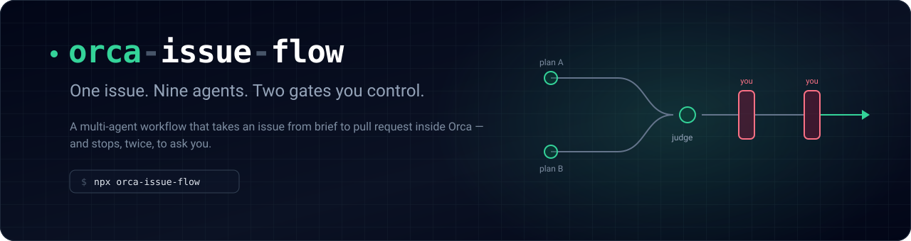
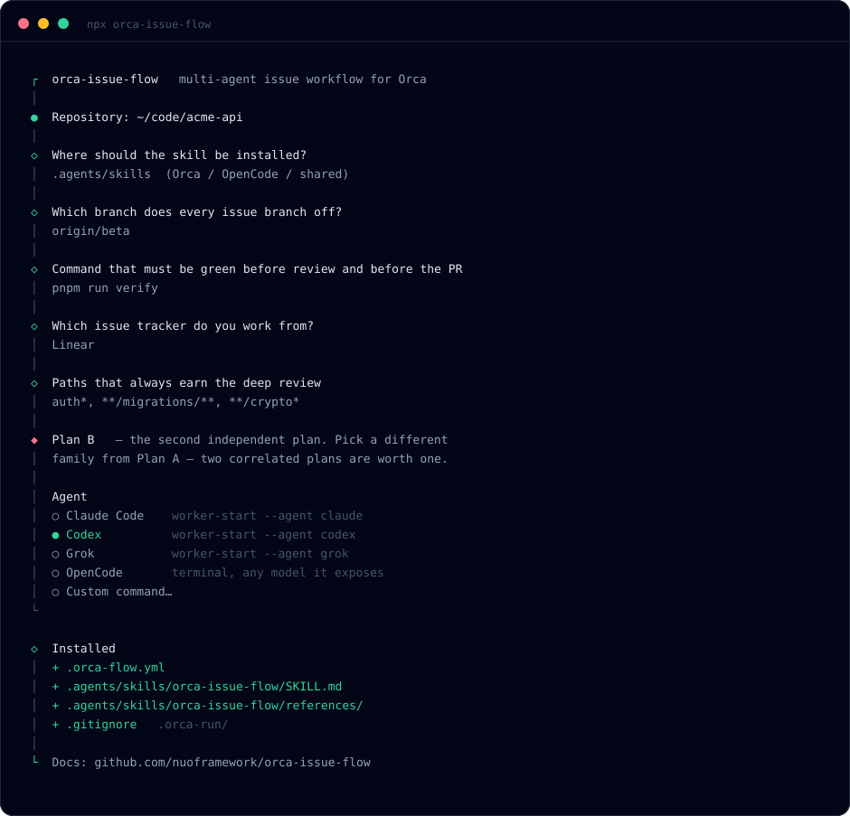
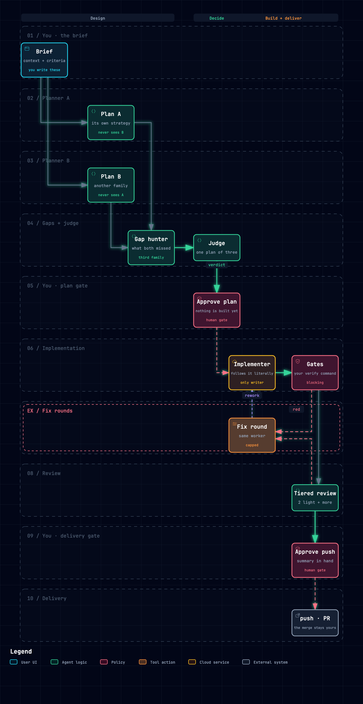

<div align="center">



<br>


</div>

<br>

Handing an issue to one agent and hoping is a coin flip you cannot audit. **orca-issue-flow**
runs a panel instead: two planners that never see each other, a third model that hunts for
what both missed, a judge that turns the three into one plan, an implementer that follows it
literally, and reviewers that are not allowed to share the implementer's blind spots.

It stops twice and asks you — once on the plan, once before anything reaches GitHub.

<br>

## Install

```bash
npx orca-issue-flow
```

<div align="center">

</div>

The wizard reads what it can from the repo — base branch, package manager, verify script,
convention files, tracker — asks about the rest, and lets you choose the agent and model
behind each of the nine roles. It writes three things:

| | |
|---|---|
| `.orca-flow.yml` | Everything project-specific. Meant to be edited. |
| `.agents/skills/orca-issue-flow/` | The skill itself. `.claude/skills/` also offered. |
| `.gitignore` | Gains `.orca-run/`, where each run leaves its artefacts. |

Then, from a session in your main checkout:

```
run issue ABC-123
```

Not on npm yet — until it is, `npx github:nuoframework/orca-issue-flow` installs the same thing.

<br>

## How a run goes

<div align="center">

<br>
<sub>Generated with <a href="https://github.com/tt-a1i/archify">Archify</a> from <a href="assets/src/flow.workflow.json"><code>assets/src/flow.workflow.json</code></a> — the interactive version is <a href="assets/flow.html"><code>assets/flow.html</code></a>.</sub>
</div>

Two properties are doing the work here, and both are easy to lose:

**The gates are real, and it is worth being exact about what makes them real.** The
orchestrator is told — in the first two of the skill's non-negotiable rules — that it has no
path to `git push`, `gh pr create` or a tracker comment before phase 11, and that it stops at
the plan and again at delivery. That is a rule, not a sandbox: an agent with a shell can
always type the command. What the flow gives you instead is a rule narrow enough to audit.
Every phase leaves its artefact under `.orca-run/`, so a run that jumped a gate shows up in
what it failed to write.

Hard enforcement wants a pre-tool hook, and a hook only binds agents whose runtime has one.
The roster is deliberately multi-vendor, so that is an open gap, not a feature — better said
plainly here than implied away.

**Nobody fixes anything in passing.** A worker that finds an unrelated bug records it and
carries on; it does not repair it. This sounds like tidiness and is not — the reviewers check
the diff against a plan you approved, so every line beyond that plan is a line nobody can
judge, and the run quietly stops being auditable. What gets found goes to
`.orca-run/50-followups.md`, and becomes an issue only if you say so at the delivery gate.

**The roles are independent.** Two planners from the same model family produce one plan with
extra steps, and the judge has nothing to arbitrate. A reviewer from the implementer's family
inherits the implementer's assumptions and approves them. Consensus between agents that think
alike is not evidence; the roster exists to avoid buying it. The
[configuration guide](skill/references/configuration.md#choosing-the-roster) says which
overlaps actually cost you something.

<br>

## The nine roles

| Role | Does | Never does |
|---|---|---|
| **Plan A** | An independent implementation plan | Sees plan B |
| **Plan B** | The second independent plan | Sees plan A |
| **Gap hunter** | Only what neither plan considered, each point with evidence | Proposes a plan |
| **Judge** | One self-sufficient final plan out of A, B and the gaps | Touches code |
| **Implementer** | Follows the approved plan, commits, runs the gates | Pushes |
| **Light review** ×2 | Hygiene, consistency, docs, "does it do what the plan said?" | Modifies files |
| **Deep review** | Security, correctness, edge cases, whether the tests would fail | Modifies files |
| **Adversarial review** | Tries to break it, assuming every other reviewer is wrong | Modifies files |

Deep and adversarial only run when the diff earns them — a risky path, a size threshold, or
the judge asking for them. A small change is four agents and two light reviews.

**And one that does not vote.** A red gate hands the implementer thousands of lines of which
forty matter — and it does not do it once, because fix rounds share the implementer's
terminal, so each round's log stacks up in the same context and round one's still reads as
current when you are on round three. A fixed failure gets fixed twice. So the **reader**, a
cheap model, extracts the failures and nothing else: verbatim, only the stack frames inside
the repo, with line numbers back into the log — which stays on disk, so the worst case is one
targeted read rather than anything lost.

It is deliberately not one of the nine. It has no opinion, and nothing downstream inherits
its taste; that is exactly why it can share a model family with any other role without
costing the flow the independence the rest of it is built on.

<br>

## Configuration

Everything project-specific lives in `.orca-flow.yml`, documented in full in
[`skill/references/configuration.md`](skill/references/configuration.md). The parts you will
actually revisit:

```yaml
language: Spanish               # what YOU read. Never the code, commits or PR body.

verify:
  command: pnpm verify          # a red gate stops the flow — make this what CI runs

deep_review_paths:              # always get the deep reviewer, whatever the diff size
  - auth*
  - "**/migrations/**"
  - "**/crypto*"

context:
  digest_gate_logs_over: 200    # above this, the verify log goes through roles.reader

roles:
  plan_b:
    launch:   orca orchestration worker-start --agent codex
    fallback: orca orchestration worker-start --agent claude --model claude-opus-4-8
```

`launch` is a command fragment, not a fixed enum — anything Orca can start, including
`orca terminal create --command "…"` for a CLI the wizard has never heard of. Re-run
`npx orca-issue-flow` any time to redo the wizard.

<br>

## What you need

- **[Orca](https://orca.computer)** with the `orca` CLI on your `PATH` and the orchestration
  skill available (`orca skills get orchestration`).
- **At least two agent CLIs** Orca can launch, from different model families. The defaults
  assume Claude Code, Codex, Grok and OpenCode; any mix works.
- **`gh`**, authenticated — used only in the last two phases.
- **A tracker, or none.** Linear and GitHub Issues are wired in; with `tracker: none` you
  paste the brief into the chat and the flow skips close-out.

<br>

## What a run leaves behind

```
.orca-run/
├── 00-context.md          what the issue asks, which code it touches
├── 01-criteria.md         numbered, each saying how it gets checked
├── 10-plan-A.md           ─┐
├── 11-plan-B.md            ├─ the disagreement, preserved
├── 12-gaps.md             ─┘
├── 13-verdict.md          the plan you approved
├── 20-gates.log           what the machine said, not what a model claimed
├── 20-gates-summary.md    the failures only, when the log outgrew a context window
├── 31-review-*.md         one file per reviewer
├── 32-findings.md         deduplicated, ordered by severity
├── 40-validation.md       criteria table + a plain-language summary for you
└── 50-followups.md        found on the way, deliberately not fixed
```

Git-ignored by default. When someone asks in six months why the code looks like this, the
answer is on disk — including the plan that lost.

<br>

## Cost, honestly

A full run is nine agent invocations plus fix rounds. That is worth it where being wrong is
expensive — auth, migrations, billing, tenant isolation, anything you would want a second
engineer to look at. It is not worth it for a typo, and the tiering means a small diff never
pays for the deep and adversarial passes.

Where the cost is worth attacking is the input nobody chose to send. A verify log is mostly
noise that looks like signal — passing lines, coverage tables, stack frames through
`node_modules` — and it is the one big blob in the run that a machine produced
deterministically rather than a person wrote. Routing it through the reader keeps it out of
the windows that are actually expensive, and out of the terminal where it would otherwise
pile up round after round. Set `context.digest_gate_logs_over: 0` to turn that off.

<br>

## Prior art and credits

This grew out of a working orchestration flow in a private production repo. Generalising it
mostly meant moving the project's assumptions out of the prompts and into config, where they
belong.

The lane diagram is built with **[Archify](https://github.com/tt-a1i/archify)**, which
compiles a typed JSON description into the artifact and refuses to render a layout where
edges cross unrelated nodes or labels collide. To rebuild it after editing the source:

```bash
npx skills add tt-a1i/archify -g
archify validate workflow assets/src/flow.workflow.json
archify render   workflow assets/src/flow.workflow.json assets/flow.html --quality showcase
```

<br>

## License

MIT
