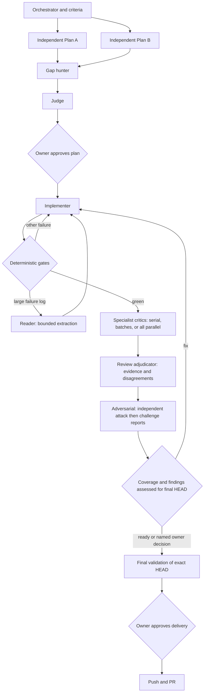

<div align="center">


<br>


</div>

<br>

Handing an issue to one agent and hoping is a coin flip you cannot audit. **orca-issue-flow**
runs a panel instead: two planners that never see each other, a third model that hunts for
what both missed, a judge that turns the three into one plan, an implementer that follows it
literally, and critics with separate sessions, evidence requirements and explicit family checks.

It stops twice and asks you — once on the plan, once before anything reaches GitHub.

<br>

## Install

```bash
npx orca-issue-flow
```

<div align="center">

</div>

The wizard reads what it can from the repo — base branch, package manager, verify script,
convention files, tracker — asks about the rest, and lets you choose the agent and model
behind each role. It writes three things:

| | |
|---|---|
| `.orca-flow.yml` | Everything project-specific. Meant to be edited. |
| `.agents/skills/orca-issue-flow/` | The skill itself. `.claude/skills/` also offered. |
| `.gitignore` | Gains `.orca-run/`, where each run leaves its artefacts. |

Then, from a session in your main checkout:

```
run issue ABC-123
```

Not on npm yet — until it is, `npx github:nuoframework/orca-issue-flow` installs the same thing.

<br>

## Upgrade existing installations

```bash
npx orca-issue-flow upgrade
npx orca-issue-flow roles
```

Version 0.2.0 uses configuration schema 2. Upgrade keeps original configuration values,
unknown keys/comments and backups, updates installed skills and adds missing policy fields.
`upgrade --skill-only` only refreshes skill files. `roles` refuses an old skill/config rather
than replacing its keys while leaving an incompatible skill installed.

Strict context enforcement remains the default and needs a host-provided adapter. An owner
may explicitly choose `--context-mode instructed` during upgrade (or in the installer),
which allows a bounded-work target and prominently discloses that 60% is NOT guaranteed.
See [configuration/migration](skill/references/configuration.md) and [context modes](skill/references/context.md).

## How a run goes



Choose context mode explicitly: enforced requires real measured admission and blocks
unsupported runtimes; instructed permits a disclosed 60% target WITHOUT a guarantee.
Strict remains the default. Cached tokens count; checkpoint at 50% when measured.
See [context enforcement and its runtime prerequisite](skill/references/context.md).
The previous [Archify diagram](assets/flow.html) is historical and predates this panel.
Each specialist, the adjudicator and the adversarial critic can return blocking findings
to the sole implementer through the shared ledger. Collect findings against a frozen
revision before editing; never let a fix race reviews still running against that revision.

The workflow relies on auditable scope, evidence and approvals:

**The gates are real, and it is worth being exact about what makes them real.** The
orchestrator is told — in the first two of the skill's non-negotiable rules — that it has no
path to `git push`, `gh pr create` or a tracker comment before phase 11, and that it stops at
the plan and again at delivery. That is a rule, not a sandbox: an agent with a shell can
always type the command. What the flow gives you instead is a rule narrow enough to audit.
Every phase leaves its artefact under `.orca-run/`, so a run that jumped a gate shows up in
what it failed to write.

Hard enforcement wants a pre-tool hook, and a hook only binds agents whose runtime has one.
The roster is deliberately multi-vendor, so that is an open gap, not a feature — better said
plainly here than implied away.

**Nobody fixes anything in passing.** A worker that finds an unrelated bug records it and
carries on; it does not repair it. This sounds like tidiness and is not — the reviewers check
the diff against a plan you approved, so every line beyond that plan is a line nobody can
judge, and the run quietly stops being auditable. What gets found goes to
`.orca-run/50-followups.md`, and becomes an issue only if you say so at the delivery gate.

**Independent reports reduce shared assumptions.** Different model families help, but
vendor diversity alone is not proof. Critics begin in separate sessions without reading
each other's reports, then the adjudicator checks evidence and preserves disagreements.

## Critical roles

| Role | Responsibility |
|---|---|
| Plan A / Plan B | Independent plans, hidden from each other |
| Gap hunter | Evidence-backed omissions in both plans |
| Judge | A self-contained plan and specialist applicability matrix |
| Implementer | Sole product writer; approved scope, commits and verification |
| UI/UX critic | Interaction, accessibility, states and browser evidence when UI changes |
| Stability / performance critic | Recovery, resource bounds, concurrency and measurements when relevant |
| Architecture critic | Boundaries, compatibility, migrations and complexity; always |
| Security critic | Trust boundaries, authorization and hostile input; always |
| Documentation critic | Public behavior, configuration and examples when relevant |
| Test critic | Regression coverage, meaningful assertions and negative cases; always |
| QA critic | Acceptance and failure scenarios in isolated environments; always |
| Review adjudicator | Reproduce/trace findings, deduplicate and retain disagreements; always |
| Adversarial critic | Independent attack, then challenge previous conclusions; always |
| Reader | Extract large logs verbatim in bounded chunks; never votes |

Criticism must be demonstrable: trigger, path:line, failure mechanism, impact and evidence.
No bug quotas. Approvals list attempted counterexamples and coverage limitations. Unverified
required behavior is incomplete. Fixes invalidate affected reviews; unaffected scopes need an explicit carry attestation.
Final adjudication and adversarial sign-off repeat against the new HEAD. Named owner-accepted
risks stay visible as accepted risks, never silently green. See [review validity](skill/references/review-validity.md). Only the implementer fixes product files.

Compared with a serial specialist chain, bounded parallel batches shorten the critical path
and reduce anchoring. Compared with the old light/deep panel, explicit specialties prevent
security, QA and test quality from disappearing behind a size threshold. The proposed
planning-to-review diagram also needs implementation, both owner gates, machine checks,
fix loops and revision binding; those remain explicit above. More critics cost more and
can add noise: scoped applicability, evidence requirements and deduplication limit that.

The reader remains: full logs stay on disk, summaries preserve original line ranges, and
repeated failures trigger targeted raw excerpts. Fresh fix sessions prevent stale failures
from accumulating. Cache reuse never justifies retaining an overfull conversation.

<br>

## Review execution and environment cleanup

Choose `review_policy.execution` in the installer: `sequential` (one specialist after
another), `parallel` (all applicable specialists at once), or `batched` (default, up to
`max_parallel: 3`). Adjudication and adversarial review still wait for their dependencies.

Docker facts are collected deterministically by the read-only collector; the model does
not invent ownership/keep-open fields. Execution checks use isolated per-critic snapshots.
The orchestrator delegates resource reconciliation to `roles.janitor`: containers, supervised
processes and settled worker sessions created by this Run. Each temporary resource has a
receipt, identity, Run label and consuming Tasks. The Janitor cleans only resources whose
last consumer finished; the coordinator releases eligible worker Dispatches and the Janitor
itself. User-kept, unknown and foreign resources are preserved. No global Docker prune or
bulk process kill. See [cleanup contract](skill/references/cleanup.md).

Latest cost check (2026-11-10): the implementer defaults to Terra medium, with DeepSeek Flash
via OpenCode as an economy reserve and Sol medium for harder repairs. Opus is reserved for
judge/security. Rates and four new completed recommender runs are documented in
[models.md](skill/references/models.md); API tariffs are not subscription task prices.

## Configuration

Everything project-specific lives in `.orca-flow.yml`, documented in full in
[`skill/references/configuration.md`](skill/references/configuration.md). The parts you will
actually revisit:

```yaml
orchestrator: a frontier model  # a note to you — the skill checks it and says something
language: Spanish               # what YOU read. Never the code, commits or PR body.

verify:
  command: pnpm verify          # a red gate stops the flow — make this what CI runs

deep_review_paths:              # force all specialists, whatever the diff size
  - auth*
  - "**/migrations/**"
  - "**/crypto*"

context:
  max_window_percent: 60
  handoff_at_percent: 50
  require_measured_usage: true
  digest_gate_logs_over: 200    # above this, the verify log goes through roles.reader

roles:
  implementer:
    launch: orca orchestration worker-start --agent codex --model gpt-6.1-terra --effort medium
    fallback: orca orchestration worker-start --agent opencode --model opencode/deepseek-v4.1-flash
    fallback_2: orca orchestration worker-start --agent codex --model gpt-6.1-sol --effort medium
```

Every role has three ordered choices: primary (`launch`), `fallback` and `fallback_2`.
Unavailable or incompatible candidates are skipped with a reason; after three, the flow
reports a blocker. Defaults use supervised workers, including OpenCode. Preflight the execution host’s model
catalog and supported flags; migrate old terminal launchers before running the new skill.

The roster comes from one of three packs — **budget** for small reversible work, **balanced**
by default, **frontier** for the issues where being wrong is expensive — or from picking a
provider and model per role. Either way the wizard checks the result
against the required family gates: different planners, and security/final adjudication
opposite the implementer. The cost-aware roster favors native Claude/Codex, uses Terra for implementation, and
retains an OpenCode economy reserve. Opus handles judge/security; lighter roles use Haiku
or Luna. A Janitor service worker reconciles temporary run resources at phase/run exit. Other overlaps
are reported as correlation notes and require fresh sessions with blind initial reports.

It also tells you when it *cannot* check — an unrecognised model name, a role with no model
at all. A roster that comes back clean because half of it was unresolvable is worse than no
check, because you read the silence as a pass.

Change your mind later without touching anything else you have edited:

```bash
npx orca-issue-flow roles
```

It rewrites only the roles section, which is why that section is last in the file.

<br>

## What you need

- **[Orca](https://orca.computer)** with the `orca` CLI on your `PATH` and the orchestration
  skill available (`orca skills get orchestration`).
- **At least two agent CLIs** Orca can launch, from different model families. The defaults
  use only Claude Code, Codex, Grok and OpenCode with explicit model choices.
- **Context mode:** enforced requires a real per-request admission adapter. Instructed
  must be explicitly selected and does not guarantee the ceiling. This package supplies
  the checker/contract, not universal runtime interception.
- **`gh`**, authenticated — read-only before delivery approval; writes only afterward.
- **A tracker, or none.** Linear and GitHub Issues are wired in; with `tracker: none` you
  paste the brief into the chat and the flow skips close-out.

<br>

## What a run leaves behind

```
.orca-run/
├── 00-context.md          what the issue asks, which code it touches
├── 01-criteria.md         numbered, each saying how it gets checked
├── 02-capabilities.md     actual runtime/model/context enforcement evidence
├── 10-plan-A.md           ─┐
├── 11-plan-B.md            ├─ the disagreement, preserved
├── 12-gaps.md             ─┘
├── 13-verdict.md          the plan you approved
├── 20-gates.log           what the machine said, not what a model claimed
├── 20-gates-summary.md    the failures only, when the log outgrew a context window
├── 30-review-manifest.json frozen revision, scope and role/model assignments
├── 31-review-*.md         one file per reviewer and reviewed HEAD
├── 32-findings.md         evidence ledger with disagreements and dispositions
├── 33-adversarial-*.md    final attacks against exact HEAD
├── checkpoints/           bounded state for fresh sessions
├── resources.d/           per-worker resource creation receipts and consumers
├── 60-resources.json      merged run-owned ledger
├── 61-cleanup-*.md        verified actions and retained/unresolved resources
├── 40-validation.md       criteria table + a plain-language summary for you
└── 50-followups.md        found on the way, deliberately not fixed
```

Git-ignored by default. When someone asks in six months why the code looks like this, the
answer is on disk — including the plan that lost.

<br>

## Cost, honestly

A full panel has fourteen opinion-bearing roles plus the Reader and Janitor service roles. Scoped
specialists can be N/A; fixes and rechecks add calls. This is intended for consequential
changes, and is excessive for a typo. Budget selects lower-effort Terra for small reversible work; it keeps the same critical
reviewers, evidence policy and final attack.

Model evidence includes seven completed [Artificial Analysis Model Recommender](https://artificialanalysis.ai/models/recommend)
queries on November 8 and four economy profiles plus verified rates on November 10. The
November 11 corrections retain this dated evidence and label native/compatibility overrides. See the [role/model rationale and observed
metrics](skill/references/models.md). Benchmark intelligence is a selection aid, not proof
of defect-finding quality. Provider access and actual reasoning settings still need preflight.

Stable prompt prefixes can save processing cost; bounded reads, the reader and fresh
sessions control occupancy. Cached input still counts. Strict 60% mode fails closed without measurement/adapter. Instructed mode requires
explicit opt-in/disclosure; the skill alone cannot enforce a runtime limit.

See [verified Orca changes and integration decisions](skill/references/orca.md) for the
current supervised-worker lifecycle, bounded output reads and Native Chat considerations.

<br>

## Prior art and credits

This grew out of a working orchestration flow in a private production repo. Generalising it
mostly meant moving the project's assumptions out of the prompts and into config, where they
belong.

The lane diagram is built with **[Archify](https://github.com/tt-a1i/archify)**, which
compiles a typed JSON description into the artifact and refuses to render a layout where
edges cross unrelated nodes or labels collide. To rebuild it after editing the source:

```bash
npx skills add tt-a1i/archify -g
archify validate workflow assets/src/flow.workflow.json
archify render   workflow assets/src/flow.workflow.json assets/flow.html --quality showcase
```

<br>

## License

MIT
